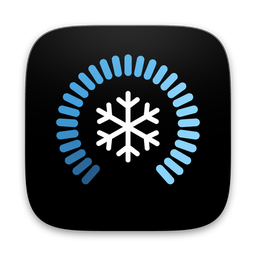
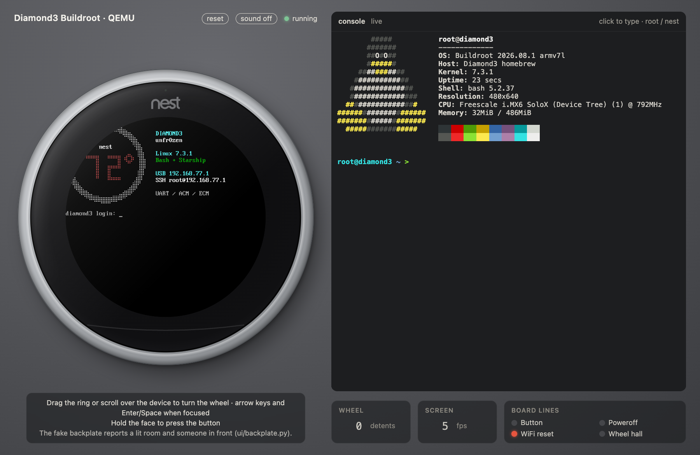

<div align="center">



# Nest Buildroot

**Your own Linux on a Nest thermostat: mainline Linux 7.3.1, systemd and a real shell, on the thermostat's own
hardware.**

[](https://buildroot.org/)
[](https://kernel.org/)
[](LICENSE)
[](https://discord.gg/fBqjAFARYg)
[](https://buymeacoffee.com/willtm)

</div>

A boilerplate for anyone building custom Linux images for Nest hardware. One `make` gives you a NAND image with
Buildroot 2026.08.1, a mainline kernel, systemd, Bash, SSH, USB serial and Ethernet, Wi-Fi and a framebuffer console;
one more boots it in [QEMU](https://github.com/unfr0zen/qemu), ring, screen and all.

<p align="center">
  
</p>

## Features

- **Mainline Linux 7.3.1** with device trees for each board, Buildroot 2026.08.1 and systemd.
- **A shell worth logging into.** Bash with Starship, SSH (Dropbear), nano, htop, btop, neofetch, iperf3, i2c-tools,
  spi-tools, evtest and libgpiod.
- **Plug in and go.** USB serial and USB Ethernet (`192.168.77.1/24`, with DHCP); Avahi advertises `diamond3.local` or
  `j49.local`, and SSH host keys are made on first boot.
- **The hardware, as Linux devices.** The ring as a `REL_DIAL` input, the button, the piezo (`nest-tone 2400 200`),
  backplate temperature, humidity, light and motion (`nest-backplate`), the battery, ADCs and GPIOs. `nest-status`
  shows it all.
- **3D on the 3rd gen.** The GC400T GPU through Etnaviv and Mesa, with kmscube.
- **Wi-Fi** through wpa_supplicant and systemd-networkd, firmware fetched by `linux-firmware`.
- **Bluetooth tools** on the 3rd gen: BlueZ, `bluetoothctl`, `btmon`.
- **Boots in QEMU** with one command: QEMU is a pinned submodule, built when first needed.
- **Self-contained.** Bootloaders are fetched with a SHA-256 check or built from Nest's GPL sources; nothing signed or
  prebuilt lives in Git.
- **Builds on Linux natively, on macOS in Docker**, automatically.

## Boards

| Nest | Board | SoC | Build | Run in QEMU | Images |
| --- | --- | --- | --- | --- | --- |
| Thermostat E | `onyx` (initial support) | i.MX6UL | `make BOARD=onyx` | `make onyx-qemu-ui` | `output/onyx/images/` |
| 3rd gen | `diamond3` | i.MX6SoloX | `make` | `make qemu-ui` | `output/images/` |
| 2nd gen | `j49` | TI AM3703 | `make BOARD=j49` | `make j49-qemu-ui` | `output/j49/images/` |

Each board's interfaces, device nodes, readings and services are in [docs/hardware.md](docs/hardware.md).

## Quick start

```sh
git submodule update --init --depth 1
make            # diamond3 image in output/images/
make qemu-ui    # boot it in QEMU and print the web page's URL
```

Log in as `root` on the serial console, or over SSH at `root@192.168.77.1` once USB is plugged in.

## Build

Linux builds natively with Buildroot's usual host dependencies; on macOS, `make` runs the build in Docker. `make
qemu-build` rebuilds QEMU explicitly.

### diamond3 (3rd gen)

The build downloads Nest's public signed `u-boot-sdp-5.2d43.hab`, verifies its SHA-256, and wraps it for NAND without
changing a signed byte.

`output/images/diamond3-buildroot.bin` is a 512 MiB logical NAND image for `unfr0zen restore`, with a `.sha256`
sidecar. Both U-Boot copies use the downloaded public image; DBBT records are generated during packaging. Recovery
preserves or regenerates the FCB and preserves the chip's bad-block table. This is not an OOB/ECC image for a raw
programmer. The public loader still needs validation on a physical unit.

### j49 (2nd gen)

```sh
make BOARD=j49
make j49-qemu-ui
```

x-loader and U-Boot are built from pinned Nest GPL sources; no signed or prebuilt bootloader is required.
`j49-buildroot.bin` includes both stages.

### onyx (Thermostat E, initial support)

```sh
make BOARD=onyx
make onyx-qemu-ui
```

The public signed Onyx SDP loader downloads with a SHA-256 check. QEMU uses open security fuses for the unsigned FIT;
closed hardware requires an authorized unlock token or a signed kernel. The 320×320 TM025ZDHG03 console uses Nest's Onyx
EVT R61529A1 panel sequence; physical display validation is pending. Wi-Fi, BLE, wheel and backplate integration remain
outside initial Onyx support.

`make onyx-qemu ROM=/path/to/onyx-rom.bin` executes a complete 96 KiB mask ROM and uploads the unchanged public loader
through its USB SDP interface.

## On the device

- **Console:** UART and USB serial give a root shell.
- **Network:** USB Ethernet at `192.168.77.1/24`, serving DHCP. SSH host keys are generated on first boot and kept on
  UBIFS.
- **Wi-Fi:** write `/etc/wpa_supplicant.conf`, then `systemctl enable --now wpa_supplicant@wlan0`. Firmware and the
  j49's NVS come from `linux-firmware`; the diamond3's radio parameters are in its board overlay. No credentials ship
  in the image.
- **Storage:** UBIFS takes the NAND space left after the boot artifacts. No OTA.

## Documentation

| Doc | What's in it |
| --- | --- |
| [docs/hardware.md](docs/hardware.md) | interfaces per board, readings and controls, Bluetooth, services |
| [unfr0zen/qemu](https://github.com/unfr0zen/qemu) | the emulator these images boot in |

## Disclaimer

This project is not affiliated with, endorsed by, or sponsored by Google LLC or Nest Labs. "Nest" and "Nest Learning
Thermostat" are trademarks of Google LLC.

## License

GPL-2.0, see [LICENSE](LICENSE).
